<!-- Two animated SVGs built by generate_assets.py in the style of megazron.com. Everything else is plain text, so the page loads fast. -->

<a href="https://megazron.com"><b>megazron.com</b></a> · <a href="https://www.linkedin.com/in/gaus-mohiuddin-sayyad/">LinkedIn</a> · <a href="https://youtube.com/@MegaZron">YouTube</a> · <a href="https://scholar.google.com/citations?user=GXrd9PIAAAAJ&hl=en">Scholar</a> · <a href="https://megazron.medium.com">Medium</a> · <a href="mailto:gmsayyadsvc4@gmail.com">Email</a>

I build the layer where <b>perception turns into action</b> — vision-language-action policies, deep-RL controllers and real-time teleoperation on real robot arms. 
MSc Human &amp; Biological Robotics @ Imperial College London · graduating Sep 2026 · <b>open to robotics &amp; embodied-AI roles</b>

<a href="https://github.com/megazron/Multimodal-control-of-a-wearable-dual-arm-robotic-system-for-assisted-object-manipulation">Twin Arms</a> ·
<a href="https://github.com/megazron/SAC-for-Multi-Functional-Assistive-Robotics-in-MuJoCo">SAC Pilot</a> ·
<a href="https://github.com/megazron/Robot-Agent-Network-for-VLAs">Agent Net</a> ·
<a href="https://github.com/megazron/eeg-operated-wheelchair">Mind Drive</a> ·
<a href="https://github.com/megazron/can-sat-for-debris-detection">Debris Hunter</a> ·
<a href="https://github.com/megazron/autonmousdrone">Coax Eye</a>

<b>OPEN THE FULL MISSION LOG</b> — experience · patents · papers · awards · stack

 

**Experience**

- **2025–26 · Huawei Technologies R&D UK** — Robotics Software Engineer (RA). Benchmarked SmolVLA, OpenVLA, Octo and π0 across 9 prompt formats and 10 LIBERO tasks; built graph-dataset generation from 3D robot episodes and the end-to-end evaluation architecture.
- **2025 · Imperial College London** — Research Assistant (microfabrication) · HBR Student Representative.
- **2025 · IIT Bombay** — Research Intern, *Satellites for Surveillance* → **GeoTRACE** (IEEE InGARSS 2025).
- **2024 · ISRO NARL** — Summer Research Fellow (IASc · INSA · NASI): atmospheric LiDAR acquisition and ML cloud retrieval.
- **2023–24 · Google Developer Student Clubs** — Lead; 800+ members mentored across 12 events.
- **2022–24 · Astronautical Society of India** — Team Leader, CanSat India 2022.

**Patents** — Germany DE202025101530U1 (EEG wheelchair), DE202025102068U1 (coaxial drone), DE202025102217U1 (3D-printing rover) · South Africa ZA 2023/01848, ZA 2023/02620 · India 540,791

**Publications** — GeoTRACE (IEEE InGARSS 2025) · Hyperspectral clay & mineral exploration (ISPRS Annals 2025) · LiDAR cloud-parameter retrieval with ML (ICCC 2025) · Flood mapping with microwave remote sensing (IJSRST 2024) — [Google Scholar](https://scholar.google.com/citations?user=GXrd9PIAAAAJ&hl=en)

**Awards** — Smart India Hackathon winner 2023 & 2024 · CanSat 2022 winner (IEEE-AESS) · Shishyottam Best Student Award · IASc-INSA-NASI Summer Research Fellowship · IIT Bombay Research Internship Award · Rank #1 in department · 53 in total on [megazron.com](https://megazron.com/#awards)

**Stack** — ROS 2 · Isaac Lab · MuJoCo · Gazebo · Kortex API · PyTorch · TensorFlow · OpenCV · VLA · SAC · PPO · ACT · diffusion policies · Python · C++ · Julia · MATLAB · TypeScript · Jetson · Raspberry Pi · FPGA · Docker · Linux

<i>Builds the impossible with science… because science works — 10 billion percent.</i>

