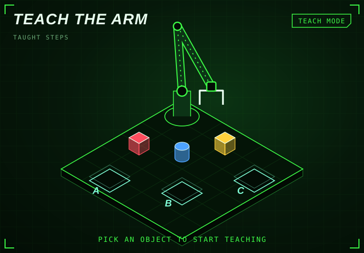

<!-- generated by generate_games.py, do not edit -->

<b>Teach the arm.</b> Show it a pick and place task one click at a time. It learns the order and repeats it by itself, even after a shuffle.

<a href="https://github.com/megazron">Back to profile</a> · <a href="https://megazron.github.io/MegaZroN/">Play the real-time 3D version</a> · <a href="../battle/README.md">Robot battle</a>

How it works: no server and no scripts. Every state of this game is its own small page with an animated SVG, and every button is a link to the next page. <code>generate_games.py</code> pre-renders all of them. Each bin holds one object, which keeps the game at about 280 pages.
