<!-- generated by generate_games.py, do not edit -->

Shuffle 1 of 3. The objects moved, the robot plans new motions and keeps the order: 1. red cube to bin B, 2. yellow cube to bin C, 3. blue cylinder to bin A.

<a href="https://github.com/megazron">Back to profile</a> · <a href="https://megazron.github.io/MegaZroN/">Play the real-time 3D version</a> · <a href="../battle/README.md">Robot battle</a>

