<!-- generated by generate_games.py, do not edit -->

Taught: 1. yellow cube to bin A, 2. blue cylinder to bin C, 3. red cube to bin B. That is the whole demonstration.

<a href="README.md">Teach again</a> · <a href="https://github.com/megazron">Back to profile</a> · <a href="https://megazron.github.io/MegaZroN/">Play the real-time 3D version</a> · <a href="../battle/README.md">Robot battle</a>

