<!-- generated by generate_games.py, do not edit -->

Step 2 of 3. The arm holds the red cube. Which bin?

<a href="README.md">Teach again</a> · <a href="https://github.com/megazron">Back to profile</a> · <a href="https://megazron.github.io/MegaZroN/">Play the real-time 3D version</a> · <a href="../battle/README.md">Robot battle</a>

