<!-- generated by generate_games.py, do not edit -->

<b>Robot battle.</b> A turn-based duel. Attack, shield, charge, or spend 2 energy on an overdrive. Every enemy telegraphs its next move: read the tell, then choose.

<a href="https://github.com/megazron">Back to profile</a> · <a href="https://megazron.github.io/MegaZroN/">Play the real-time 3D version</a> · <a href="../arm/README.md">Teach the arm</a>

Rules: attack does 1 damage. Shield takes 2 off the incoming hit. Charge gives 1 energy (3 at most). Overdrive costs 2 energy and does 3 damage. A guarding enemy takes 2 less, a venting enemy takes 1 more. I act first, so a destroyed enemy does not hit back. A fight lasts at most 9 rounds. No server and no scripts: every state is a pre-rendered page from <code>generate_games.py</code>.
