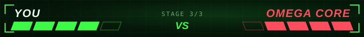
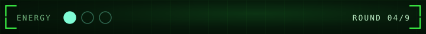

<!-- generated by generate_games.py, do not edit -->

<a href="../README.md">Restart battle</a> · <a href="https://github.com/megazron">Back to profile</a> · <a href="https://megazron.github.io/MegaZroN/">Play the real-time 3D version</a> · <a href="../../arm/README.md">Teach the arm</a>

